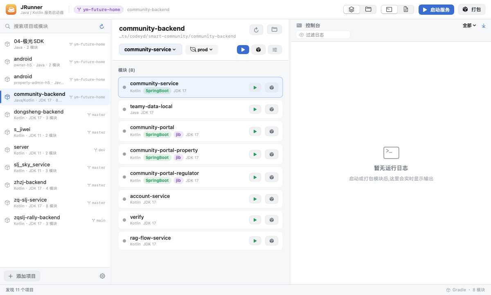
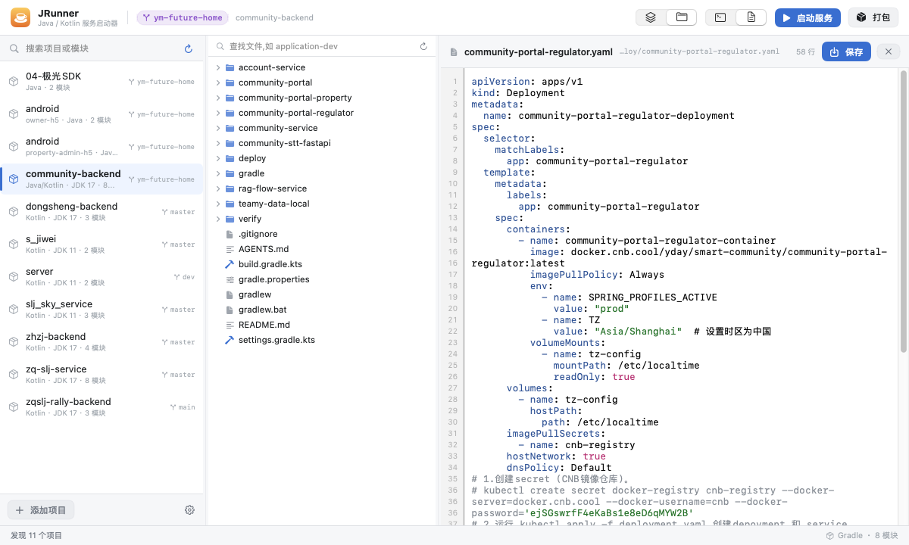
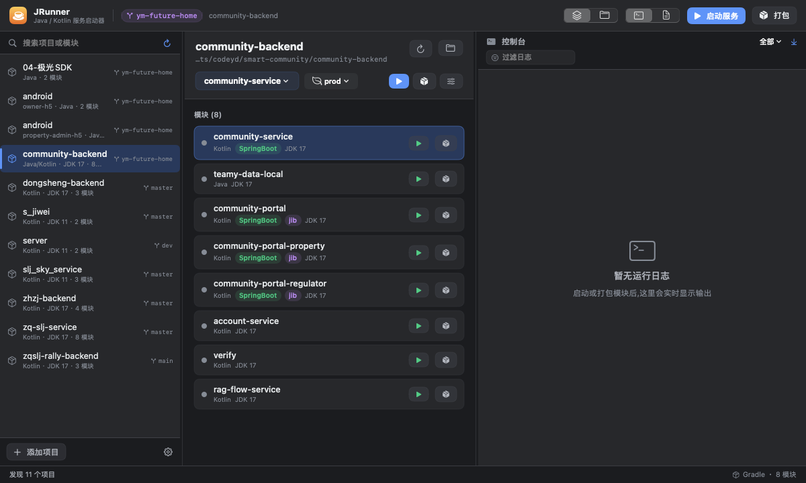

# JRunner

> 轻量级 Java 服务启动器 —— 一个原生 macOS 小工具，替代笨重的 IDE 来跑 Spring Boot 老项目。

[](https://github.com/lq0910/jrunner/releases/latest)
[](#环境要求)
[](LICENSE)

不想为了启动一个后端服务就开一个 2GB 的 IDE？JRunner 只做几件事：**一键启动、一键打包、看日志、改配置、切分支**，启动是秒级的。



## 下载

从 [Releases](https://github.com/lq0910/jrunner/releases/latest) 下载 `JRunner-<version>.dmg`（或 `.zip`），把 `JRunner.app` 拖进「应用程序」。

应用是 ad-hoc 签名、未做 Apple 公证，首次打开若提示「无法验证开发者」，右键 → 打开，或执行：

```bash
xattr -dr com.apple.quarantine /Applications/JRunner.app
```

> 发布包是 arm64 + x86_64 通用二进制，Apple Silicon 和 Intel 都能跑。

## 特性

### 一键启动 / 打包

- 自动识别 Gradle / Maven 项目，列出所有子模块
- 启动走 `bootRun`，打包走 `jib`（镜像推送到仓库）
- 自动匹配项目 `gradle-wrapper.properties` 里声明的 Gradle 版本，避免版本不兼容
- 自动从 `application-*.yaml` 提取 Spring Profile，可在界面上直接切换（切数据库环境不用改文件）

### 实时日志

- 流式输出，ANSI 转义自动清理，按级别（错误 / 警告 / 信息 / 调试）过滤着色
- 启动失败时自动提取 `Caused by:` / `APPLICATION FAILED TO START` 段落置顶显示，不用在几千行里翻
- 从日志里自动识别端口，停止服务时精确回收（只杀自己启动的 java 进程）

### 文件树 + 代码编辑

- 内嵌文件树，直接改 `application-dev.yaml` 这类配置
- 带语法高亮（YAML / Properties / Java / Kotlin / XML / JSON / SQL / Markdown / Shell）和行号
- 高亮用 `NSLayoutManager` 临时属性实现，不污染文本、不影响撤销和查找



### Git 分支：显示 + 切换

- 标题栏常驻当前分支，点开就是本地分支列表，选中即 `git checkout`
- 切换成功后自动重新识别项目 —— 不同分支的模块、JDK、profile 都可能不一样
- 切换失败（比如有会冲突的未提交改动）会把 git 的原始报错原样弹出来，而不是一句「失败了」
- 侧边栏每个项目行尾显示各自分支；有未提交改动时显示圆点
- 直接解析 `.git/HEAD` / `packed-refs`，不走 git 进程，切项目无感
- 支持游离 HEAD（显示短 SHA）、worktree、submodule；切回前台自动刷新

### 深色模式：跟随系统，也可手动锁定

标题栏右上角一键切换「跟随系统 / 浅色 / 深色」，选择会记住。跟随系统时，macOS 切深浅色界面和编辑器实时响应，无需重启。

实现上改的是 `NSApp.appearance` 而不是 SwiftUI 的 `.preferredColorScheme` —— 后者只作用于窗口内容，标题栏和弹窗仍是系统外观，深色下会「半黑半白」。



### 三栏联动

「模块列表 ↔ 调试日志」「文件树 ↔ 代码编辑器」成对切换，切换时中栏宽度自动调整到合适值。所有分栏都可以拖拽调宽。

## 快速开始

需要 macOS 13+ 和 Xcode 命令行工具。

```bash
git clone https://github.com/lq0910/jrunner.git
cd jrunner
./build.sh
open JRunner.app
```

`build.sh` 会做四件事：读 `VERSION` → release 编译 → 组装 `.app` bundle（含图标、版本号）→ ad-hoc 签名。

首次打开会自动扫描 `~/Documents`、`~/Projects`、`~/IdeaProjects` 等常见目录下的项目；也可以点左下角「添加项目」指定路径。

## 版本与发布

版本号的**唯一来源**是仓库根目录的 `VERSION` 文件，打包时注入 `Info.plist` 的 `CFBundleShortVersionString`，界面上状态栏右下角和「关于 JRunner」都能看到。

```
VERSION                  # 当前版本号 —— 改这里,别手改 Info.plist
Packaging/Info.plist     # bundle 模板,含 __VERSION__ / __BUILD__ 占位符
icon_1024.png            # 图标源图(由 make_icon.swift 生成,别手改)
scripts/
├── build_app.sh         # 唯一构建入口(本机 / release.sh / CI 共用)
├── make_icon.swift      # 画 icon_1024.png(橙色渐变 + 咖啡杯)
├── release.sh           # 编译 → zip + dmg → 校验和 → 可选发 Release
├── release_notes.sh     # 按提交前缀生成 Release Notes
└── bump-version.sh      # 版本号自增
```

### 发一个新版本

```bash
scripts/bump-version.sh patch     # 1.0.0 → 1.0.1
git add VERSION && git commit -m "chore: 发布 v1.0.1"
git push origin HEAD
```

推上去就完事了。`.github/workflows/release.yml` 检测到 `VERSION` 变更后会：

1. 在 Ubuntu runner 上算版本号、检查 `v1.0.1` 是否已存在（幂等，重复推送不会报错）
2. 在 macOS runner 上编通用二进制 → 打 zip / dmg → 生成校验和与 Release Notes → 冒烟检查（解包、`plutil`、`lipo`、`codesign --verify`）
3. 创建标签 `v1.0.1` 并发布 GitHub Release

也支持手动推标签（`git push origin v1.0.1`）或在 Actions 页面点 **Run workflow** 指定版本号补发。

### 本地打包（不发 Release）

```bash
scripts/release.sh              # 产物在 dist/,不动远端
scripts/release.sh --tag        # 额外创建本地标签
scripts/release.sh --publish    # 创建标签 + 推送 + gh 发 Release(CI 挂了时的兜底)
```

## 环境要求

| 项目 | 说明 |
|---|---|
| macOS | 13.0+ |
| JDK | 通过 `/usr/libexec/java_home -V` 自动探测，支持多版本共存 |
| Gradle | 优先用项目自带的 wrapper，找不到时回退到 `~/.gradle/wrapper/dists` 里的版本 |
| Maven | 使用 `~/.m2` 本地仓库 |

## 目录结构

```
Sources/JRunner/
├── JRunnerApp.swift      # App 入口、菜单命令、AppDelegate
├── MainView.swift        # 三栏布局、工作区联动、标题栏
├── AppStore.swift        # 全局状态：项目、任务、配置、外观
├── Models.swift          # Project / Module 模型与项目扫描器
├── TaskPlanner.swift     # 把模块翻译成 gradle / mvn 命令
├── ProcessTask.swift     # 子进程执行、日志流、端口探测
├── JDKResolver.swift     # JDK 探测与版本匹配
├── GitInfo.swift         # 分支读取 / 列出 / 切换与状态缓存
├── CodeEditor.swift      # 语法高亮 + 行号栏（NSTextView）
├── FileModels.swift      # 文件树 / 编辑器数据模型
├── FileBrowser.swift     # 文件树与编辑器视图
├── LogConsole.swift      # 日志控制台
├── ProjectSidebar.swift  # 项目侧边栏
├── ModuleDetailPanel.swift
├── SettingsSheet.swift
├── Appearance.swift      # 深色 / 浅色 / 跟随系统
├── Version.swift         # 从 Info.plist 读版本号
├── DesignSystem.swift    # 配色、按钮、徽章等基础组件
├── Shell.swift           # 登录 shell 环境变量恢复
└── AppConfig.swift       # 模块配置持久化
```

## 一些实现上的坑（给想改代码的人）

- **GUI 程序拿不到 `~/.zshrc` 的 PATH**：从 Finder 启动的 App，PATH 只有 `/usr/bin:/bin`，会找不到 gradle / mvn。所以启动子进程前会用 `zsh -lc env` 把用户环境捞回来。
- **不能对 Gradle 用 `waitUntilExit()`**：Gradle daemon 会继承 stdout 管道，进程永远不返回。改用 `terminationHandler`，并在结束时关闭读端。
- **Gradle 版本必须匹配**：用系统最新版 Gradle 跑老项目会报 `LenientConfiguration.getArtifacts` 之类的错，所以优先读 wrapper 声明的版本。
- **`NSSize(width: .greatestFiniteMagnitude)` 有歧义**：必须写 `CGFloat.greatestFiniteMagnitude`，否则编译器会在后面几百行报一堆无关的假错误。
- **macOS 自带 bash 是 3.2**：`set -u` 下展开空数组会报 `unbound variable`，脚本里得写成 `${arr[@]+"${arr[@]}"}`。
- **`Menu` 的 `.borderlessButton` 标签会丢修饰符**：padding / background 写在 label 里会被丢掉，胶囊底直接消失。所有样式必须加在 `Menu` 外层。

## License

[MIT](LICENSE)
